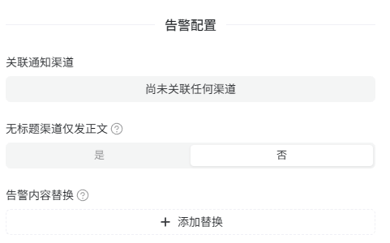
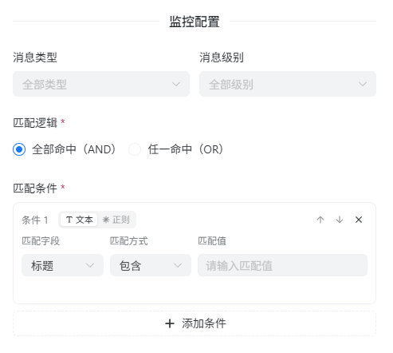
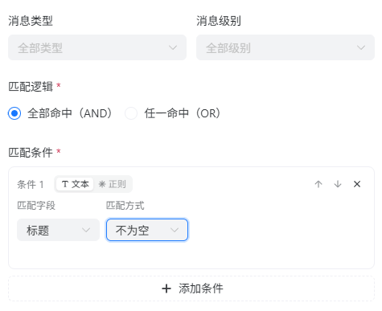
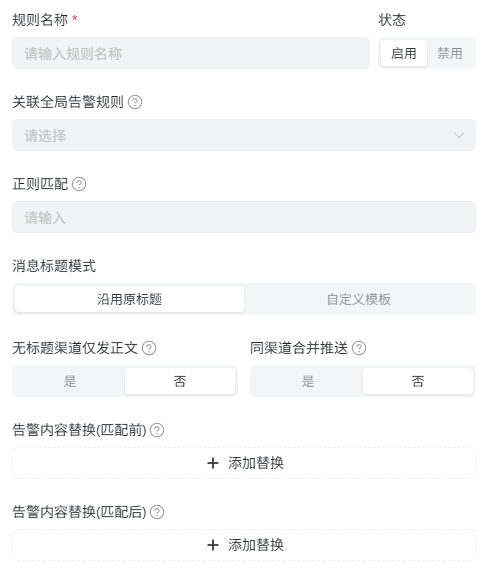

平台消息中心功能提供了基础的消息聚合与管理能力，监控告警是平台消息中心板块的功能之一。

> 本质上你可以将监控告警功能视为消息监控转发，在 Arcadia 平台我们会把消息推送这一行为称为“告警”。

## 规则类型

消息中心监控告警规则分为 `全局规则` 和 `一对一规则`，分别提供基础的监控告警能力和一对一告警能力。

### 全局规则

- #### 告警配置

    

    告警配置区域用于控制消息匹配后的推送目的地与消息内容。  
    不绑定通知渠道则不会发送告警消息，同时为了能够修改原消息内容设计了以下两个配置项：
    - 无标题渠道仅发正文 = 去掉标题，只发送正文内容
    - 告警内容替换 = 正则替换消息内容，可添加多个正则规则

- #### 监控配置

    

    监控配置区域用于定义匹配规则，消息类型和消息级别是基础的筛选条件，默认匹配全部类型。  
    如果你接触过一些消息转发类的APP，那么你在看到匹配逻辑与匹配条件时并不会感到陌生，匹配条件支持文本和正则两种形式。

    如果你想匹配全部消息，那么你可以如下图这样简易配置就能实现

    

### 一对一规则

<Callout type="info" title="一对一规则不能单独触发">
全局规则是主入口，它能够决定要不要把匹配到的消息交给一对一告警规则处理，你可以在一对一规则编辑表单中绑定全局规则。
</Callout>

- #### 工作原理

    首先，我们把一对一的告警（推送）对象称为收信人，每位收信人都有一个唯一的识别标识。平台会根据收信人标识匹配消息内容所在行并截取整行内容从而实现针对特定收信人的消息告警（推送），如果命中了多行则会汇总为一条告警消息。

    平台没有设计复杂的文字截取机制，所以这意味着如果你想实现一对一告警功能那么有一个很重要的前提条件：  

    > 每条收信人的消息在整个消息内容中独占一行，相当于每个收信人规则命中都会截取整行内容。

- #### 关于 “正则匹配”

    作用于全部收信人的自定义正则匹配表达式。默认直接匹配标识符，如果需要更复杂的匹配逻辑，可以在此处编写正则表达式。

- #### 关于 “同渠道合并推送”

    如果你想给处于同一个群组/频道内的一部分收信人统一推送一对一消息，你可以利用该功能将多个收信人的告警消息重新聚合为一条告警消息，从而减少重复推送。

## 节流队列

由于新增的一对一告警功能带来了数千条告警消息推送压力的潜在业务场景，为了满足高并发情况下的处理需求，平台引入了节流队列机制。节流队列会对告警消息进行排队处理，确保在高并发情况下不会出现消息丢失或重复推送的情况。了解更多细节详见[《节流队列》](/docs/message#节流队列)。

## 告警失败处理

当告警事件关联通知渠道推送失败时，平台会向消息中心发送一条提醒消息。针对同一条消息的一对一告警失败消息会自动进行汇总，避免重复提醒。  
不论是全局规则还是一对一规则，所有的告警失败提醒消息都不会再被监控告警引擎二次触发，从而避免告警循环。
